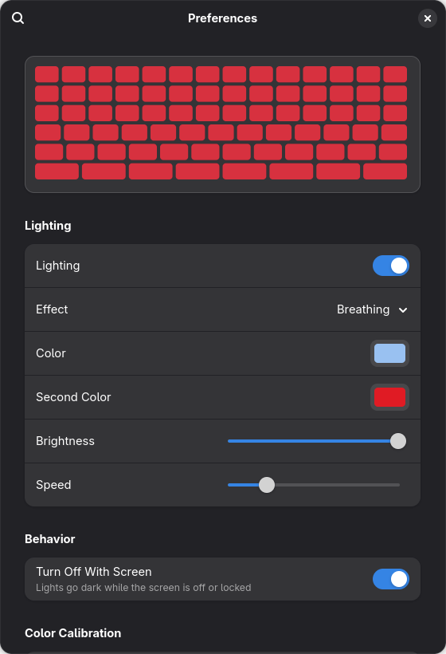
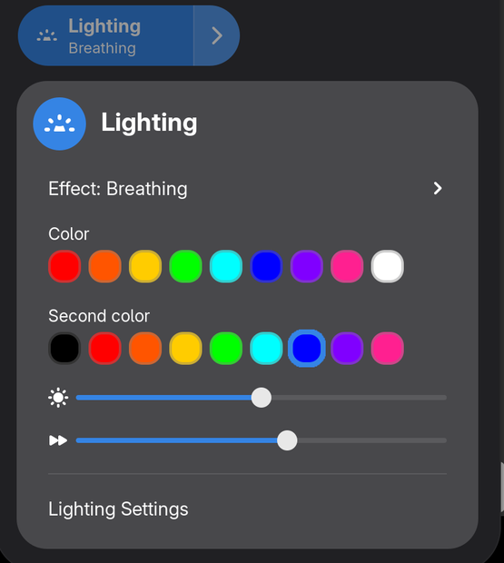

# Lamplight

**Keyboard RGB lighting on Linux for laptops that use Windows Dynamic Lighting.**

[](https://github.com/egeisik35/lamplight/actions/workflows/test.yml)

[](https://extensions.gnome.org/extension/11264/lamplight/)

<p align="center">
  
  
</p>

On Windows, some laptops let you set the keyboard color under
*Settings > Personalization > Dynamic Lighting* or in MyASUS. On Linux, the
keyboard stays on whatever color the firmware chose. Lamplight brings that
control to Linux as a GNOME extension: a Quick Settings tile, a settings
window with a live preview, and a command-line tool.

These keyboards speak **HID LampArray**, the open USB HID standard behind
Dynamic Lighting. ROG-focused tools such as asusctl do not handle it.
Lamplight works with any LampArray device: it reads the report layout, lamp
count and lamp positions from the device itself, with no per-model table.

- Effects: solid, match GNOME accent color, breathing, color cycle, rainbow,
  wave, wheel, gradient, firmware effect, off
- Brightness, speed and direction controls (right, left, up, down, outward,
  inward; clockwise or counterclockwise for wheel), like Windows
- Turns the lights off while the screen is off or locked, and restores them
  after suspend
- On laptops, the brightness slider stays in sync with the Fn backlight keys
  and GNOME's keyboard brightness
- Hides itself on computers without a LampArray device
- No root needed at runtime; a udev rule grants access only to LampArray devices
- Color calibration (white balance and gamma) to match LED colors to the screen
- A small background service applies the settings; without GNOME, use the CLI
  or `gsettings`

## Supported hardware

Lamplight works with devices whose firmware exposes a native HID LampArray.
Report IDs and sizes differ between devices, so lamplight reads them from each
device's descriptor instead of hardcoding them.

**Tested with lamplight:**

| Device | Controller | Lamps |
|--------|-----------|-------|
| ASUS Vivobook S 14 M5406KA | ITE5570 `0b05:5570` (I2C) | 1 |

**Known LampArray hardware:** other open-source projects confirm these on Linux.
"Descriptor checked" means lamplight parsed that device's published report
descriptor correctly.

| Device | Controller | Confirmed by | Descriptor checked |
|--------|-----------|--------------|--------------------|
| ASUS Vivobook S 14 / S 16 (M5406, M5606, S5406) | ITE5570 `0b05:5570` or `0b05:19b6` | [vivobook-rgb](https://github.com/matcraft94/vivobook-rgb), [vrgb](https://github.com/MHS-20/vrgb) | yes |
| ASUS TUF Gaming A16 (FA608) | ITE5570 `0b05:19b6` | [asusctl #148](https://github.com/OpenGamingCollective/asusctl/issues/148) | no (same ID as Vivobook S5406) |
| Lenovo LOQ IRX10 (24 zones) | ITE `048d:c693` | [lampctl](https://github.com/Salvo6516/lampctl) | yes |
| Acer Predator Helios 16 PH16-72 (per key) | Sunrex `05af:666a` | [lamparray-kbd](https://github.com/usamathpc/lamparray-kbd) | no |
| GIGABYTE GAMING A16 | `0414:8105` / `0414:8104` | [Gigabyte-Gaming-A16-Linux-KB-Drivers](https://github.com/Luminous418/Gigabyte-Gaming-A16-Linux-KB-Drivers) | no |

Run `lamplight info` to check your device. Please
[open a device report](https://github.com/egeisik35/lamplight/issues/new?template=device-report.yml),
whatever the result.

**Not supported:** some vendors add Dynamic Lighting through a Windows-only
driver instead of the device firmware. Those devices do not show a LampArray
on Linux, and lamplight cannot see them. Single-color (white) keyboard
backlights are not LampArrays either; GNOME already controls their
brightness.

**Known quirk:** some keyboards (for example the GIGABYTE A16) handle their
Fn brightness keys only in firmware mode. Use the **Built-in effect** mode to
get them back.

Position-based effects (rainbow, wave, wheel, gradient) need a per-key
keyboard. On a single-zone keyboard, they color the whole keyboard at once.

## Install

### Easiest: GNOME Extensions (GNOME 48–51)

1. Open the **Extension Manager** app, or
   [extensions.gnome.org](https://extensions.gnome.org/extension/11264/lamplight/),
   search for **Lamplight** and install it.
2. Open Quick Settings, open the **Lighting** tile and choose
   **Set up keyboard access…** once. It asks for your password to allow your
   user to use the keyboard lighting device.

That's all. The extension brings its own backend. It needs Python 3 with
PyGObject, which GNOME systems normally have. All settings, including the
live preview and color calibration, are in its settings window: the gear
icon in Extension Manager, or **Lighting Settings** in the tile.

The packages below install the same thing system-wide, plus the `lamplight`
command.

### Arch Linux

Download `lamplight-*-any.pkg.tar.zst` from the
[latest release](https://github.com/egeisik35/lamplight/releases/latest), then:

```sh
sudo pacman -U lamplight-*-any.pkg.tar.zst
```

Or build it yourself:

```sh
git clone https://github.com/egeisik35/lamplight.git
cd lamplight
makepkg -si
```

An AUR package will follow once AUR account registration reopens.

### Other distributions

You need Python 3.9 or newer.

```sh
git clone https://github.com/egeisik35/lamplight.git
cd lamplight
sudo make install
```

You need PyGObject (`python3-gi` on Debian/Ubuntu, `python3-gobject` on
Fedora).

`make install` installs everything. To install only some parts:

| Command | Installs | Needs |
|---------|----------|-------|
| `sudo make install-cli` | `lamplight` command and udev rule | Python 3.9+ |
| `sudo make install-service` | CLI + background service | + PyGObject |
| `sudo make install-extension` | service + GNOME extension (tile and settings window) | + GNOME Shell 48–51 |

To remove everything, run `sudo make uninstall`.

After installing, log out and back in once. The service starts with your
session.

### GNOME tile

The tile is installed with the package. Turn on **Lamplight** in the
Extensions app, and a **Lighting** tile appears in Quick Settings. When the
package is installed, the extension uses its service; otherwise it runs its
bundled backend.

## Command line

```sh
lamplight info                              # list devices
lamplight solid -c ff5500 -b 60             # orange at 60 % brightness
lamplight breathe -c 00ffff -s 5            # cyan, 5 s per breath
lamplight wave -c ff0000 -c 0000ff -d out  # red over blue, from the center
lamplight firmware                          # hand back to the built-in effect
lamplight off
```

| Option | Meaning |
|--------|---------|
| `-c RRGGBB` | color; give it twice to set the second color |
| `-b 0-100` | brightness in percent |
| `-s SECONDS` | effect period; lower is faster |
| `-d DIRECTION` | `right` `left` `down` `up` `out` `in`; `cw` `ccw` for wheel |

Animated modes run until you press Ctrl+C.

If the background service is running, it owns the lighting and will repaint
over a CLI command during animated effects. Stop it first with
`systemctl --user stop lamplight`, or change settings through `gsettings`
(see below).

## Troubleshooting

**`Permission denied`**: the udev rule did not apply. Run:

```sh
sudo udevadm control --reload-rules
sudo udevadm trigger --subsystem-match=hidraw
```

**`no HID LampArray device found`**: your device does not expose a
LampArray. Please open a device report with the output of
`grep -H HID_NAME /sys/class/hidraw/*/device/uevent`.

**Nothing changes when I pick a color**: check that the service runs:
`systemctl --user status lamplight`. Start it with
`systemctl --user enable --now lamplight`.

## How it works

Lamplight talks to `/dev/hidraw*` with HID feature reports. It uses the
LampArray reports from the HID Usage Tables (Lighting and Illumination page,
`0x59`):

| Report | Use |
|--------|-----|
| LampArrayAttributes | lamp count, size, kind, minimum update interval |
| LampAttributesRequest / Response | position of each lamp |
| LampMultiUpdate | per-lamp colors, sent in chunks |
| LampRangeUpdate | one color for all lamps |
| LampArrayControl | firmware (autonomous) mode on or off |

`lamplight service` runs in the background as a systemd user service. It
reads the settings (GSettings schema `org.gnome.shell.extensions.lamplight`), renders
the effect, and follows the screen saver and suspend. The tile and the
settings window only change settings. You can script it too:

```sh
gsettings set org.gnome.shell.extensions.lamplight mode wave
gsettings set org.gnome.shell.extensions.lamplight color 'ff0000'
```

### Color accuracy

Screens encode colors with a gamma curve, while LEDs respond linearly, and
each LED channel has its own strength. Lamplight decodes colors with gamma 2.2
by default, and the **Color Calibration** section of the settings window lets you lower a
channel until white looks white on your keyboard. The same settings work from
a terminal:

```sh
gsettings set org.gnome.shell.extensions.lamplight white-balance '(1.0, 1.0, 0.63)'
gsettings set org.gnome.shell.extensions.lamplight gamma 2.2   # 1.0 sends raw values
```

LEDs show purer colors than a screen, so a perfect match is not possible;
calibration gets close.

### Permissions

With the GNOME extension alone, **Set up keyboard access…** writes static
rules for the devices present (by bus and USB/I2C ID) to
`/etc/udev/rules.d/70-lamplight-extension.rules` using `pkexec`. Run it
again after adding a new lighting device.

The udev rule runs `lamplight probe` on each hidraw device. Only devices with
a LampArray get the `uaccess` tag, which gives the logged-in user access. The
rule is numbered 70 because `uaccess` must come before
`73-seat-late.rules`.

hidraw access also lets the user read that device's input reports. On laptop
lighting controllers, these are not keystrokes. A mouse that has its buttons
and LEDs on the same interface would expose its button reports.

## Development

```sh
make test     # unit tests against real descriptors (see tests/THIRD_PARTY.md)
make zip      # GNOME extension zip for extensions.gnome.org
```

## Related projects

Other Linux tools for LampArray keyboards, each focused on its own hardware or
interface:

- [vivobook-rgb](https://github.com/matcraft94/vivobook-rgb) and its fork
  [vrgb](https://github.com/MHS-20/vrgb): CLI for ASUS Vivobook keyboards
- [lamparray-kbd](https://github.com/usamathpc/lamparray-kbd): per-key CLI,
  tested on the Acer Predator Helios 16
- [lampctl](https://github.com/Salvo6516/lampctl): generic CLI in C
- [Gigabyte-Gaming-A16-Linux-KB-Drivers](https://github.com/Luminous418/Gigabyte-Gaming-A16-Linux-KB-Drivers):
  GIGABYTE A16 keyboard
- [asusctl](https://github.com/OpenGamingCollective/asusctl): ASUS laptop
  daemon, with LampArray support in progress for TUF models
- Linux kernel: a proposed `hid-lamparray` helper exposes LampArray devices as
  a single-color LED. Per-key control is meant to stay in user space.

Lamplight adds animated effects with directions, a GNOME Quick Settings tile,
accent-color sync, and screen-off handling, for any LampArray device.

## Contributing

See [CONTRIBUTING.md](CONTRIBUTING.md). Device reports are the most useful
contribution.

## License

MIT
